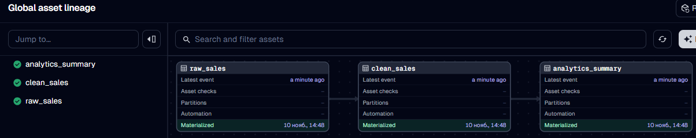
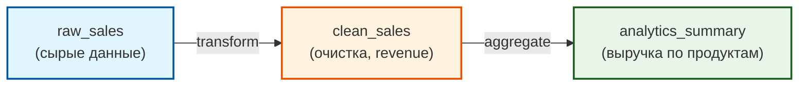

# 🚀 Dagster Orchestration Demo

Pet-проект: оркестрация данных с использованием **Dagster**. Демонстрирует asset-centric подход (оркестрация данных, а не задач) и построение графа зависимостей.

## 📸 Скриншот

**Граф зависимостей (Lineage):**


## 🎯 Зачем это

Dagster — это современный оркестратор, который ставит в центр не «задачи» (как Airflow), а **данные (assets)**. В этом проекте показано, как построить пайплайн `raw_sales → clean_sales → analytics_summary`, где каждый шаг — это ассет (таблица или датафрейм), а Dagster автоматически строит граф зависимостей и отслеживает статус материализации.

## 📖 Что такое Asset (Asset-centric подход)

В Airflow ты пишешь: «выполни задачу А, потом задачу Б». В Dagster ты пишешь: «есть таблица `raw_sales`, а есть `clean_sales`, которая зависит от `raw_sales`». Dagster сам понимает, в каком порядке их материализовать, и показывает граф.

## 🏗 Архитектура



## 📂 Структура

```
dagster-orchestration-demo/
├── dagster_demo/
│   ├── __init__.py
│   └── assets.py          # Определение ассетов
├── assets/
│   └── lineage_graph.png  # Скриншот графа
├── README.md
└── requirements.txt
```

## 🚀 Запуск

1. Установи зависимости:
```bash
pip install -r requirements.txt
```

2. Запусти Dagster UI:
```bash
dagster dev -f dagster_demo/assets.py
```

3. Открой браузер (обычно `http://127.0.0.1:3000`).

4. Нажми **«Materialize selected (3)»** — Dagster выполнит все три ассета по цепочке.

## 📊 Результаты

- **3 ассета:** `raw_sales`, `clean_sales`, `analytics_summary`.
- **Успешная материализация:** все три ассета получили статус «Materialized».
- **Lineage:** Dagster автоматически построил граф зависимостей (скриншот выше).

## 🔗 Связанные проекты

- [`airflow-e2e-api-pipeline`](https://github.com/nconichtchenko-arch/airflow-e2e-api-pipeline) — пример на Airflow (для сравнения).
- [`raw-clean-analytics-demo`](https://github.com/nconichtchenko-arch/raw-clean-analytics-demo) — трехслойная архитектура на Airflow.

## 📫 Контакты

- **GitHub:** [github.com/nconichtchenko-arch](https://github.com/nconichtchenko-arch)
- **Email:** pavloni@mail.ru
- **Формат работы:** удалённо